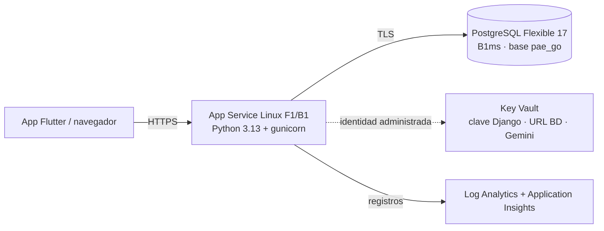

# Despliegue en Azure (App Service + PostgreSQL)

Infraestructura como código (Bicep) para desplegar la plataforma web de PAEGo con
[Azure Developer CLI](https://aka.ms/azd). Es una alternativa a Railway (`cd.yml`).



| Archivo | Qué hace |
|---|---|
| `azure.yaml` | Servicio `web` = carpeta `backend/` en App Service (Python). |
| `infra/main.bicep` | Crea el grupo `rg-<entorno>` y llama a `resources.bicep`. |
| `infra/resources.bicep` | Identidad, Key Vault (RBAC) y secretos, PostgreSQL, plan F1/B1, web app, monitoreo. |
| `infra/main.parameters.json` | Toma los valores de las variables del entorno de azd. |
| `backend/startup.sh` | Arranque: `migrate`, `createcachetable`, `collectstatic`, `seed_demo` (opcional), gunicorn. |
| `backend/.webappignore` | Lo que no se sube (`.env`, `.venv`, `media/`…). |
| `.github/workflows/azure.yml` | Despliegue continuo (`azd deploy`) tras el CI verde de `main`. |

### Costo

Con **Azure for Students** queda prácticamente en US$0:

| Recurso | Plan | Costo |
|---|---|---|
| PostgreSQL Flexible B1ms, 32 GB | Oferta gratuita 12 meses (750 h/mes + 32 GB + 32 GB de respaldo) | US$0 |
| App Service | **F1** por defecto: gratis siempre, 60 min de CPU al día, sin Always On | US$0 |
| Key Vault, Log Analytics, Application Insights | por uso (Log Analytics: 5 GB/mes gratis) | centavos |

Limitaciones de F1: la app se descarga tras ~20 min sin uso (la primera petición tarda) y,
si se acaban los 60 min de CPU del día, responde 403 hasta el día siguiente. El conductor
manda su posición cada 3 s, así que para una demostración o un piloto conviene subir a B1
**solo esos días** (US$0,0238/h ≈ US$0,57 al día en Chile Central) y bajar después:

```powershell
$plan = azd env get-value APP_SERVICE_PLAN_NAME
az appservice plan update -g rg-paego-prod -n $plan --sku B1   # demostración
az appservice plan update -g rg-paego-prod -n $plan --sku F1   # de vuelta a gratis
```

Para que un `azd provision` posterior no lo devuelva a F1: `azd env set APP_SERVICE_SKU B1`.

## 1. Preparar el PC (una vez)

```powershell
winget install microsoft.azd
winget install Microsoft.AzureCLI
az login
azd config set auth.useAzCliAuth true   # azd usa la sesión de az
```

Si `azd` dice que no hay suscripciones justo después de activar Azure for Students, borrar
`%USERPROFILE%\.azd\subscriptions.cache` y volver a intentar.

## 2. Elegir la región

Las suscripciones de **Azure for Students** solo permiten desplegar en algunas regiones
(política "Allowed resource deployment regions"). Consultarlas:

```powershell
az policy assignment list --query "[].{nombre:displayName, regiones:parameters.listOfAllowedLocations.value}" -o json
```

En la suscripción del proyecto la política permite `northcentralus`, `belgiumcentral`, `westus2`,
`chilecentral` y `brazilsouth`, pero **F1 tiene cuota 0 en `northcentralus` y falla en
`westus2`**. Se usa **`chilecentral`** (F1 y B1 funcionan, y es la más cercana a Pasto). Si
PostgreSQL no se puede crear en la región elegida, definir `POSTGRES_LOCATION` con otra permitida.

## 3. Crear el entorno y los secretos

```powershell
azd env new paego-prod
azd env set AZURE_LOCATION chilecentral
# Secretos (quedan en .azure/, que está en .gitignore; nunca commitearlos):
azd env set POSTGRES_ADMIN_PASSWORD "<contraseña larga>"
azd env set DJANGO_SECRET_KEY (python -c "import secrets; print(secrets.token_urlsafe(64))")
azd env set GEMINI_API_KEY "<clave nueva de Gemini>"   # opcional
azd env set PAEGO_SEED_DEMO true                       # datos demo para la sustentación
```

## 4. Revisar y desplegar

```powershell
azd provision --preview   # lista lo que se va a crear, sin crear nada
azd up                    # crea la infraestructura y despliega backend/
```

Al terminar azd muestra `WEB_URI` (`https://azwa<token>.azurewebsites.net`). El primer
arranque tarda unos minutos (Oryx instala las dependencias). Registros en vivo:

```powershell
az webapp log tail -g rg-paego-prod -n (azd env get-value WEB_APP_NAME)
```

## 5. (Opcional) Traer los datos de Railway

```powershell
# Agregar temporalmente la IP del PC al firewall de PostgreSQL:
az postgres flexible-server firewall-rule create -g rg-paego-prod -n (azd env get-value POSTGRES_HOST).Split('.')[0] -r mi-pc --start-ip-address <IP> --end-ip-address <IP>
pg_dump "<DATABASE_PUBLIC_URL de Railway>" -Fc --no-owner -f railway.dump
pg_restore --clean --no-owner -d "postgres://paegoadmin:<contraseña>@<POSTGRES_HOST>:5432/pae_go?sslmode=require" railway.dump
# Y quitar la regla al terminar (firewall-rule delete).
```

### Cargar el mes de datos demo (`demo_mes`)

`demo_mes` exige una base sin envíos (la auditoría inmutable no deja borrarlos), así que hay que
recrear `pae_go`. Desde el PC, con una regla temporal de firewall para su IP:

```powershell
# DATABASE_URL = postgres://paegoadmin:<contraseña>@<POSTGRES_HOST>:5432/pae_go?sslmode=require
# (recrear la base pae_go desde la base postgres, p. ej. DROP DATABASE pae_go WITH (FORCE); CREATE DATABASE pae_go)
python manage.py migrate; python manage.py createcachetable
python manage.py demo_mes --institucion "Normal Superior"
az webapp restart -g rg-paego-prod -n (azd env get-value WEB_APP_NAME)   # conexiones viejas → 500
```

## 6. Despliegue continuo desde GitHub

```powershell
azd pipeline config --provider github
```

Crea una identidad con credencial federada (OIDC, sin contraseñas) y define en el repo las
variables `AZURE_CLIENT_ID`, `AZURE_TENANT_ID`, `AZURE_SUBSCRIPTION_ID`, `AZURE_ENV_NAME`,
`AZURE_LOCATION`. Desde entonces `.github/workflows/azure.yml` despliega cada vez que el CI de
`main` pasa. Requiere permisos para crear identidades en Entra ID (en algunas cuentas de
estudiante no están; en ese caso desplegar a mano con `azd deploy`).

## 7. La app móvil

Compilar con `PAEGO_API_URL=<WEB_URI>` (variable de repo `PAEGO_API_URL` en el repo de Flutter
para los builds de CI y release). Para la versión web de Flutter agregar su origen a
`corsAllowedOrigins` en `main.parameters.json`.

## Apagar o borrar

- Pausar la base: `az postgres flexible-server stop -g rg-paego-prod -n <servidor>` (se
  reinicia sola a los 7 días). Dentro de la oferta gratuita no hace falta; sí al pasar los 12
  meses. El plan B1 cobra mientras exista aunque la app esté detenida: para "pausarlo", bajarlo
  a F1.
- Borrar todo: `azd down`. El Key Vault queda en eliminación temporal 7 días con protección de
  purga (no se puede purgar antes): para volver a crear el entorno antes de ese plazo usar
  otro nombre de entorno.

## Medición en F1 (Chile Central, noviembre 2026)

| Qué | Resultado |
|---|---|
| `azd up` completo | 8,7 min (infraestructura 6,6 + código 2) · `azd deploy` solo: ~2 min |
| Arranque (`migrate` + `collectstatic` + `seed_demo` + gunicorn) | ~15 s de CPU |
| Conductor mandando posición cada 3 s | ~20 peticiones/min ≈ 0,5 s de CPU por minuto; latencia p50 377 ms, p95 499 ms |
| Primera petición tras 25 min sin tráfico | 1,0 s (el proceso siguió vivo: F1 no lo descargó en ese lapso) |
| Arranque en frío real (reinicio del contenedor, sin `seed_demo`) | 40,6 s hasta el primer 200 |
| Prueba E2E de Flutter (`PAEGO_E2E_URL=<WEB_URI> flutter test test/e2e`) | 4/4 en 9 s |

Con 60 min de CPU al día, F1 alcanza para ~100 horas-conductor diarias de transmisión GPS (p. ej.
6 conductores × 5 h ≈ 15–20 min de CPU), más el panel. El límite real de F1 para la sustentación
es el arranque en frío y no tener Always On; para eso subir a B1 ese día.

## Notas

- App Service manda `X-Forwarded-For` como `ip:puerto`; `apps/auditoria/servicios.py` quita el
  puerto y valida la IP (antes el login respondía 500).

- Las fotos de evidencia se guardan en `/home/paego/media` (persistente). Igual que en
  Railway, en producción Django no las sirve por URL; verlas desde el panel requiere
  agregar esa ruta (o pasar a Azure Blob Storage) más adelante.
- `seed_demo` es idempotente; con `PAEGO_SEED_DEMO=false` no se cargan datos demo.
